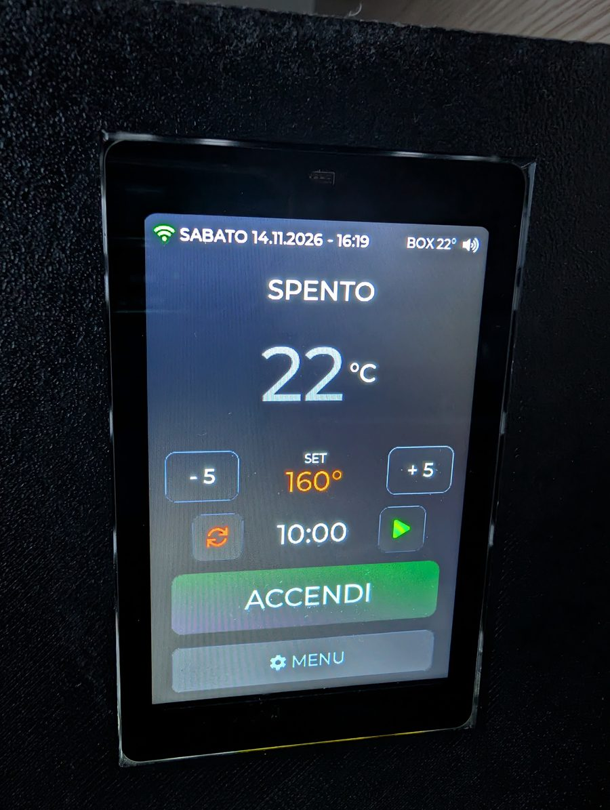
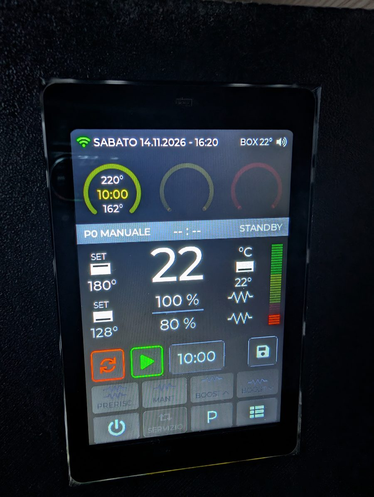
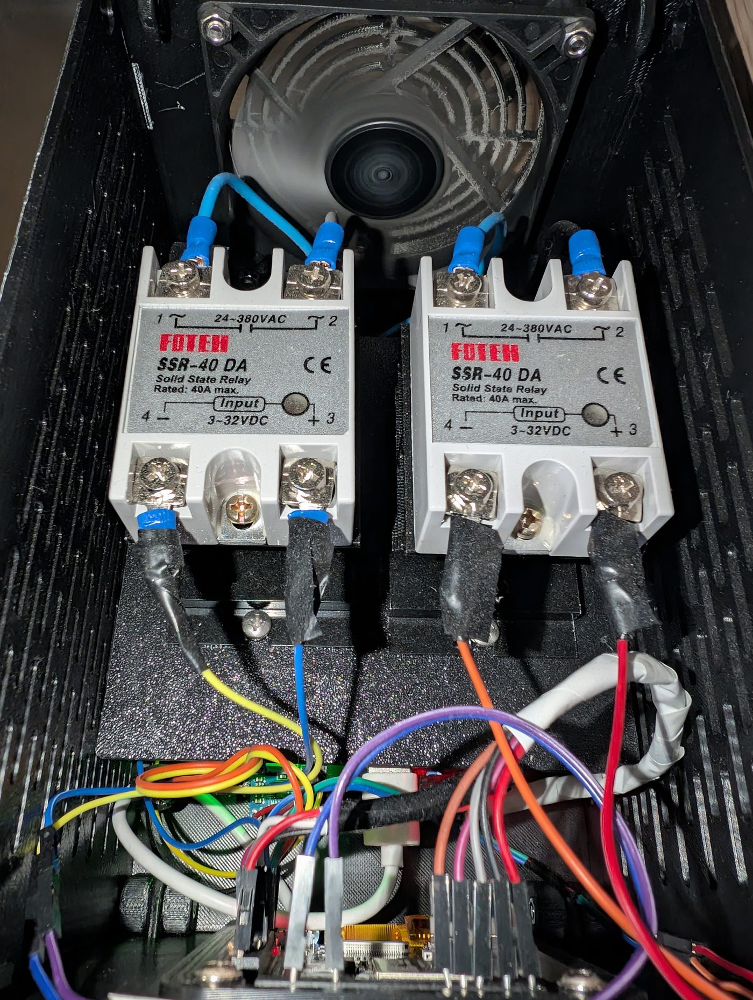
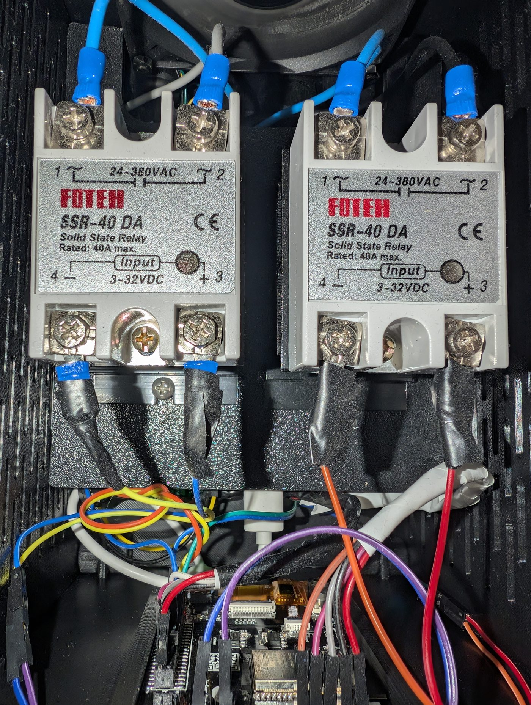

# PYRO — controller touch per forno elettrico da pizza

*[Read in English](README.md)*

PYRO trasforma un forno elettrico da pizza economico, con due termostati
meccanici, in un forno a controllo digitale. Due termocoppie, due relè a stato
solido e un ESP32 con touchscreen gestiscono separatamente la resistenza di
cielo e quella di platea. Il controller impara come scalda il forno, ti dice
quando la pietra è davvero pronta e si comanda anche dal telefono.

Il forno di partenza è un **Vevor 14" a camera singola** (1000 W cielo + 1000 W
platea, 230 V), con isolamento aggiuntivo in fibra ceramica. L'interfaccia touch
si ispira ai controller dei forni da pizza professionali.

| Modalità SEMPLICE | Modalità PRO |
|---|---|
|  |  |

> [!CAUTION]
> **Questo progetto lavora con la tensione di rete (230 V) e con un
> apparecchio che arriva a 500 °C.** Un errore di cablaggio può uccidere o
> provocare un incendio, e un relè a stato solido che si guasta in corto tiene
> accesa la resistenza qualunque cosa dica il firmware. Costruiscilo solo se
> sai lavorare sugli impianti a 230 V. Lascia una protezione termica hardware
> in serie alle resistenze, collega a terra ogni parte metallica e non lasciare
> mai il forno acceso senza sorveglianza. Modificare il forno ne annulla la
> garanzia e la certificazione. Tutto il materiale è fornito così com'è, senza
> garanzie: costruzione e uso sono a tuo rischio.

## Funzioni

- **Due zone indipendenti**: cielo e platea, ognuna con il suo set e la sua
  potenza, comandate da un SSR in burst firing (periodo 1 s, 100 passi da 10 ms).
- **Due schermate**, che si possono cambiare in qualunque momento:
  - **SEMPLICE**: una sola temperatura, ACCENDI/SPEGNI, timer, boost cielo e
    platea. I set di cielo e platea si ricavano da una tabella di taratura
    misurata su questo forno.
  - **PRO**: l'interfaccia completa in stile professionale, con fino a 3 fasi
    di cottura, preriscaldamento/mantenimento/boost, potenza per zona e
    modalità servizio pizze.
- **20 programmi** (P0-P19), modificabili dal touch o dal browser: pizze
  (napoletana, romana, teglia, americana…), pane, arrosti, torte, gratin.
- **Apprendimento termico**: velocità di salita per fascia di temperatura,
  overshoot e potenza di mantenimento si imparano con l'uso e restano salvati in
  flash. Il preriscaldamento è bilanciato, così cielo e platea arrivano insieme.
- **Pronto davvero**: la sonda platea sta sotto la pietra, quindi "sonda a
  temperatura" non vuol dire "pietra pronta". Il firmware aspetta che il duty
  della platea si stabilizzi (pietra satura) e mostra un tempo stimato, calcolato
  con un modello esponenziale adattato ai dati appresi.
- **Infornata e recupero**: un calo rapido della sonda cielo vuol dire porta
  aperta e pizza dentro, e il forno va a piena potenza per recuperare.
- **Avvio programmato**: accensione a un orario, mantenimento per un tempo
  stabilito, poi spegnimento.
- **Stima del raffreddamento**: i minuti che mancano prima che il forno scenda
  sotto i 40 °C.
- **Controllo web** su `http://pyro.local/`: dashboard dal vivo (SEMPLICE + PRO),
  grafico, editor dei programmi, API REST, aggiornamento firmware OTA.
- **Sicurezza**: tetto assoluto a 530 °C, boost limitato a set + 30 °C,
  riconoscimento dei guasti delle sonde, ventola ferma, scatola del controller
  troppo calda, standby automatico dopo 1 h di inattività, spegnimento a
  pressione prolungata, watchdog.

## Contenuto del repository

| Percorso | Contenuto |
|---|---|
| `firmware/oven_controller/` | Firmware ESP32 (PlatformIO, Arduino, LVGL 8.3, LovyanGFX) |
| `telemetria/` | Logger Python (`logger.py`) che registra una sessione di cottura in CSV |
| `documentazione/` | Distinta componenti, note sul firmware, storico |

## Hardware

### Distinta componenti

Elenco completo con i prezzi: [`documentazione/BOM.md`](documentazione/BOM.md)
(circa 330 € compreso il forno).

| Componente | Note |
|---|---|
| Forno elettrico da pizza, 2 resistenze | Vevor 14", 1000 W cielo + 1000 W platea, 230 V |
| **WT32-SC01** | ESP32 + touch capacitivo 3,5" 320×480 (l'SC01 originale con display ST7796 SPI, *non* l'SC01 Plus) |
| 2 × modulo MAX31855 | Amplificatore per termocoppia tipo K, SPI |
| 2 × termocoppia tipo K | Sonde per alta temperatura (fino a ~500 °C), in tubi ceramici isolanti |
| 2 × SSR-40DA + dissipatori | SSR zero-cross, ingresso 3-32 VDC, uscita 24-380 VAC |
| Alimentatore 12 V 60 W | Alimenta la ventola e lo step-down |
| Step-down DC-DC 12 → 5 V | Alimenta il WT32-SC01 |
| Ventola PC 12 V 4 pin | Raffredda la scatola del controller; il segnale TACH viene controllato |
| Buzzer passivo | Pilotato in PWM |
| Connettori rotondi GX16 | Collegano la scatola del controller al forno |
| Cavo in silicone 1,5 mm² | Cablaggio a 230 V resistente al calore |
| Fibra ceramica + nastro metallico | Isolamento aggiuntivo della camera (facoltativo ma consigliato) |
| Scatola stampata in 3D | Per il controller |

### Posizione delle sonde

- **Sonda cielo**: in camera, sotto la resistenza superiore. Reagisce in pochi
  secondi, per questo serve anche a riconoscere l'infornata.
- **Sonda platea**: sotto la pietra refrattaria, non sulla superficie di
  cottura. A regime la superficie della pietra è più calda di quanto legge la
  sonda, ed è per questo che il firmware aspetta che la pietra sia satura.

Entrambe attraversano la carcassa in un tubo ceramico, così la termocoppia non
tocca mai il metallo.

### Dentro la scatola

| Vista d'insieme | Dettaglio |
|---|---|
|  |  |

I due SSR-40DA sono montati sui dissipatori, con la ventola da 12 V sopra che
soffia attraverso la scatola. Il lato in alternata (morsetti 1-2, in alto) porta
la fase alle resistenze. Gli ingressi in continua (morsetti 3-4, in basso) vanno
al WT32-SC01, che si vede in fondo, di spalle, con i cavetti sul connettore di
espansione. La scatola è stampata in 3D, con feritoie di ventilazione sui lati.

### Collegamenti in bassa tensione (connettore di espansione del WT32-SC01)

| WT32-SC01 | Va a | Note |
|---|---|---|
| GPIO33 | CLK di entrambi i MAX31855 | clock SPI in comune |
| GPIO32 | DO di entrambi i MAX31855 | dati in comune |
| GPIO26 | CS del MAX31855 **cielo** | |
| GPIO27 | CS del MAX31855 **platea** | |
| 3V3 / GND | Vin / GND di entrambi i MAX31855 | |
| GPIO12 | SSR cielo, ingresso + (DC+) | pin di strapping: niente pull-up |
| GPIO2 | SSR platea, ingresso + (DC+) | pin di strapping: niente pull-up |
| GND | ingresso − (DC−) di entrambi gli SSR | |
| GPIO4 | buzzer passivo + | buzzer − a GND |
| GPIO5 | TACH della ventola (filo verde) | pull-up interno, 2 impulsi/giro |
| GPIO0 | PWM della ventola (filo blu) | facoltativo: nel prototipo non è collegato e la ventola gira a 12 V fissi |
| 5V / GND | uscita dello step-down 12 → 5 V | |

Il +12 V della ventola (giallo) arriva dall'alimentatore, il suo GND (nero) è in
comune con il WT32-SC01. Display e touch usano pin interni al modulo (vedi
`firmware/oven_controller/src/hardware_pins.h`).

```
                  ┌──────────────────────┐
 MAX31855 cielo  ─┤ GPIO26 CS            │
 MAX31855 platea ─┤ GPIO27 CS            ├─ GPIO12 ──► SSR cielo  (DC+)
 entrambi        ─┤ GPIO33 CLK           ├─ GPIO2  ──► SSR platea (DC+)
 entrambi        ─┤ GPIO32 DO            ├─ GND    ──► entrambi   (DC−)
                  │      WT32-SC01       ├─ GPIO4  ──► buzzer
 step-down 12→5 V ┤ 5V / GND             ├─ GPIO5  ◄── TACH ventola
                  └──────────────────────┘
```

### Collegamenti a 230 V

La scatola del controller si collega al forno con connettori GX16: uno per
l'alimentazione della scatola (L, N, PE), uno per ogni termocoppia e uno per le
resistenze.

```
  L ──┬──────────────────────────────► alimentatore 12 V (L)
      ├── SSR cielo  (1 → 2) ────────► resistenza cielo  ──┐
      └── SSR platea (1 → 2) ────────► resistenza platea ──┤
  N ───────────────────────────────────────────────────────┴──► alimentatore 12 V (N)
  PE ─────────────────────────────────► carcassa del forno, parti metalliche della scatola, terra dell'alimentatore
```

- La fase entra nella scatola su un pin comune, si sdoppia sui due SSR e torna
  al forno su due pin separati, uno per resistenza. Il neutro delle resistenze
  resta collegato dentro il forno.
- La corrente è 4,35 A per resistenza e 8,7 A in tutto: basta cavo in silicone
  o H05VV-F da 1,5 mm², con connettori di portata ben superiore.
- **Lascia una protezione termica (fusibile termico o limitatore bimetallico)
  in serie alle resistenze**, indipendente dall'elettronica. Gli SSR si guastano
  in corto.
- Monta gli SSR sui dissipatori e lascia la scatola ventilata. Il firmware
  spegne il forno se la scatola supera i 70 °C (misurati dal giunto freddo dei
  MAX31855) o se la ventola si ferma.

## Firmware

### Compilare e caricare

Serve [PlatformIO](https://platformio.org/) (da riga di comando o come
estensione di VS Code) e, su Windows, il driver USB CP210x per il WT32-SC01.

```bash
cd firmware/oven_controller
pio run                 # compila
pio run -t upload       # carica via USB
pio device monitor      # log seriale, 115200 baud
```

Le librerie (LVGL 8.3, LovyanGFX, Adafruit MAX31855) le scarica PlatformIO.
Schema delle partizioni `min_spiffs.csv` (due slot OTA da ~1,9 MB).

### Primo avvio

1. Il forno parte in modalità SEMPLICE, in standby.
2. **WiFi**: *Impostazioni → WiFi → Configura rete*. Le credenziali restano
   salvate in flash. Se vuoi averle già nel firmware come riserva, copia
   `src/wifi_secrets.example.h` in `src/wifi_secrets.h` (ignorato da git).
3. **Fuso orario**: l'ora arriva via NTP, il fuso è `TZ_INFO` in
   `src/wifi_config.h` (predefinito `CET-1CEST`, Italia).
4. Apri `http://pyro.local/` da un dispositivo sulla stessa rete.

Gli aggiornamenti successivi passano dal WiFi: compila e carica
`.pio/build/esp32-sc01/firmware.bin` da `http://pyro.local/ota`.

### Adattarlo al tuo forno

PYRO è tarato per resistenze da 1000 W + 1000 W. Con un forno diverso:

- il profilo termico parte da valori misurati su questo forno e si adatta da
  solo nelle prime sessioni (`thermal_profile.cpp`);
- gli scostamenti cielo/platea della modalità SEMPLICE sono una tabella
  misurata su questo forno (`SIMPLE_CAL` in `ui_auto.cpp`);
- potenze e temperature dei programmi sono in `programs_storage.cpp`.

Pin e limiti di sicurezza sono in `src/hardware_pins.h`.

## Controllo web e API

Con il WiFi attivo il controller espone:

| Percorso | |
|---|---|
| `/` | Dashboard (schede SEMPLICE + PRO, grafico dal vivo) |
| `/programs` | Editor dei programmi |
| `/ota` | Aggiornamento firmware |
| `GET /api/status` | Stato in JSON |
| `POST /api/command` | Comandi, corpo JSON `{"cmd":"...","v":...}` |

Campi principali di `/api/status`: `on`, `mode`, `tc`/`tp` (temperatura cielo
e platea), `ta` (scatola), `sc`/`sp` (set), `epc`/`epp` (potenza effettiva),
`rc`/`rp` (resistenza accesa), `tm`/`ts`/`tact` (timer), `pn`/`prog`
(programma), `stone` (pietra pronta), `eta`, `cool` (minuti al raffreddamento),
`aoff` (secondi allo standby automatico).

Comandi:

| Gruppo | `cmd` |
|---|---|
| Accensione | `power_on`, `power_off`, `power_on_simple` (SEMPLICE, con preriscaldamento) |
| Temperatura | `set_temp` (SEMPLICE), `set_temp_cielo`, `set_temp_platea` |
| Potenza % | `set_power_cielo`, `set_power_platea` |
| Timer | `timer_set` (min), `timer_set_s` (s), `timer_start`, `timer_pause`, `timer_reset` |
| Boost | `boost_cielo`, `boost_platea` (on/off) |
| Modalità | `preheat`, `maintain`, `cooking`, `service_on`, `service_off` |
| Programmi | `program` (indice), `phase` |
| Schermata | `mode_semplice`, `mode_pro` |
| Avvio programmato | `sched_set` (`v` = minuti dalla mezzanotte, `t` = temperatura, `d` = timer in s), `sched_off` |
| Keep-alive | `ping` (azzera il conteggio di inattività) |

**Non c'è autenticazione**: tieni il forno su una rete domestica fidata e non
esporlo mai su internet.

## Telemetria

`telemetria/logger.py` interroga `/api/status` ogni 2 s e scrive un CSV:

```bash
python telemetria/logger.py pyro.local
```

Serve a vedere come scalda e recupera il tuo forno, e a tarare programmi e
modalità SEMPLICE.

## Licenza

Codice e documentazione: [MIT](LICENSE).
Il materiale di terzi incluso mantiene la sua licenza: font Montserrat (SIL Open
Font License, `documentazione/Montserrat/OFL.txt`) e le librerie scaricate in
compilazione (LVGL MIT, LovyanGFX FreeBSD, Adafruit MAX31855 BSD).

Il progetto non è affiliato a Vevor né ad altri produttori di forni; i nomi dei
prodotti servono solo a descrivere l'hardware.
