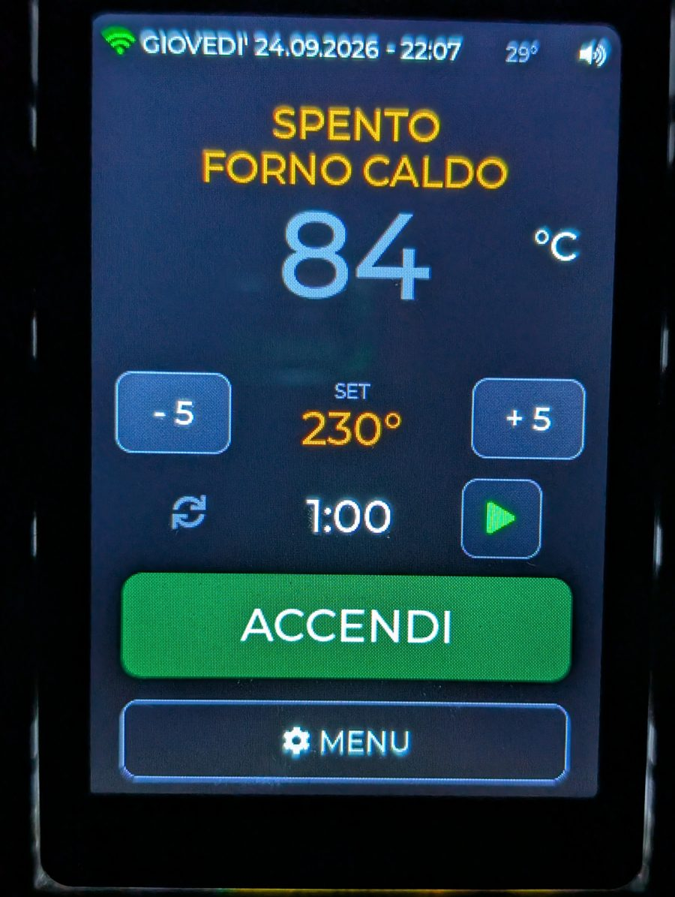
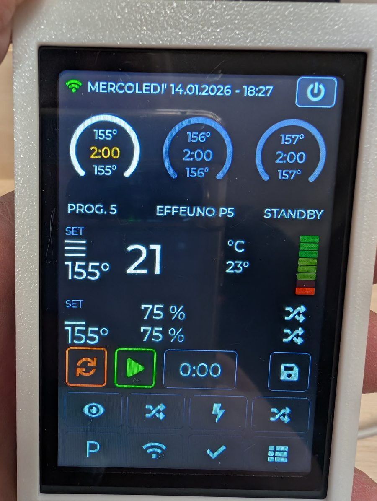

# PYRO — touchscreen controller for an electric pizza oven

*[Leggi in italiano](README.it.md)*

PYRO turns a cheap electric pizza oven with two mechanical thermostats into a
digitally controlled oven: two thermocouples, two solid-state relays and an
ESP32 touchscreen that runs the top and bottom heating elements independently,
learns how the oven heats up, tells you when the stone is really ready and can
be driven from a phone.

It was built on a **Vevor 14" single-chamber pizza oven** (1000 W top + 1000 W
bottom, 230 V) with extra ceramic-fibre insulation. The touch interface is
inspired by professional pizza-oven controllers.

| SEMPLICE mode | PRO mode |
|---|---|
|  |  |

> [!CAUTION]
> **This project works with mains voltage (230 V) and with an appliance that
> reaches 500 °C.** A wiring mistake can kill you or start a fire; a solid-state
> relay that fails shorted keeps the element on whatever the firmware says.
> Build it only if you are competent with mains wiring, keep a hardware thermal
> cut-off in series with the elements, earth every metal part and never leave
> the oven unattended. Modifying the oven voids its warranty and its
> certification. Everything here is provided as is, with no warranty: you build
> and use it at your own risk.

> [!NOTE]
> The user interface and the code comments are in **Italian**.

## Features

- **Two independent zones**: top (*cielo*) and bottom (*platea*) with their own
  set-point and power, each driven by an SSR with burst firing (1 s period,
  100 steps of 10 ms).
- **Two screens**, switchable at any time:
  - **SEMPLICE** (simple): one temperature, ON/OFF, timer, top/bottom boost. The
    top and bottom set-points are derived from a calibration table measured
    on this oven.
  - **PRO**: the full professional-style interface with up to 3 cooking phases,
    preheat/maintain/boost, per-zone power and a pizza service mode.
- **20 programs** (P0-P19), editable on the screen or from the browser: pizza
  styles (Neapolitan, Roman, pan, American…), bread, roasts, cakes, gratins.
- **Thermal auto-learning**: heating rate per temperature band, overshoot and
  holding power are learned during normal use and saved in flash. The preheat
  is balanced so both zones arrive together.
- **Real readiness**: the bottom probe sits under the stone, so "probe at
  temperature" does not mean "stone ready". The firmware waits until the
  bottom element's duty cycle settles (stone soaked) and shows an ETA based on
  an exponential model fitted on the learned data.
- **Bake detection and recovery**: a fast drop of the top probe means the door
  was opened and a pizza went in; the oven goes to full power to recover.
- **Scheduled start**: switch on at a given time, hold the temperature for a
  set time, then switch off.
- **Cool-down estimate**: minutes until the oven is below 40 °C.
- **Web remote** at `http://pyro.local/`: live dashboard (SEMPLICE + PRO), chart,
  program editor, REST API, OTA firmware update.
- **Safety**: absolute 530 °C limit, boost capped at set-point + 30 °C,
  thermocouple fault detection, cooling-fan stall detection, controller box
  over-temperature, 1 h inactivity auto-standby, hold-to-switch-off, loop
  watchdog.

## Repository layout

| Path | Content |
|---|---|
| `firmware/oven_controller/` | ESP32 firmware (PlatformIO, Arduino, LVGL 8.3, LovyanGFX) |
| `telemetria/` | Python logger (`logger.py`) that records a cooking session to CSV |
| `documentazione/` | Bill of materials, firmware notes, changelog |

## Hardware

### Bill of materials

Full list with prices: [`documentazione/BOM.md`](documentazione/BOM.md) (about €330 including the oven).

| Part | Notes |
|---|---|
| Electric pizza oven, 2 elements | Vevor 14", 1000 W top + 1000 W bottom, 230 V |
| **WT32-SC01** | ESP32 + 3.5" 320×480 capacitive touch (the original SC01 with ST7796 SPI display, *not* the SC01 Plus) |
| 2 × MAX31855 breakout | Type K thermocouple amplifier, SPI |
| 2 × type K thermocouple | High-temperature probes (up to ~500 °C), in ceramic insulating tubes |
| 2 × SSR-40DA + heatsinks | Zero-cross SSR, input 3-32 VDC, output 24-380 VAC |
| 12 V 60 W power supply | Feeds the fan and the step-down |
| DC-DC step-down 12 → 5 V | Feeds the WT32-SC01 |
| 12 V 4-pin PC fan | Cools the controller box; the TACH signal is monitored |
| Passive buzzer | PWM driven |
| GX16 round connectors | Plug the controller box into the oven |
| Silicone wire, 1.5 mm² | Heat-resistant mains wiring |
| Ceramic fibre + metal tape | Extra insulation around the chamber (optional but recommended) |
| 3D-printed case | For the controller box |

### Probe placement

- **Top probe (cielo)**: in the chamber, under the top element. It reacts within
  seconds, so it is also used to detect when a pizza goes in.
- **Bottom probe (platea)**: under the refractory stone, not on the cooking
  surface. The stone surface is measurably hotter than this probe at regime,
  which is why the firmware waits for the stone to soak.

Both go through the oven shell in ceramic tubes, so the thermocouple never
touches the metal.

### Low-voltage wiring (WT32-SC01 expansion connector)

| WT32-SC01 | Goes to | Notes |
|---|---|---|
| GPIO33 | CLK of both MAX31855 | shared SPI clock |
| GPIO32 | DO of both MAX31855 | shared data |
| GPIO26 | CS of the **top** MAX31855 | |
| GPIO27 | CS of the **bottom** MAX31855 | |
| 3V3 / GND | Vin / GND of both MAX31855 | |
| GPIO12 | SSR top, input + (DC+) | strapping pin: do not add pull-ups |
| GPIO2 | SSR bottom, input + (DC+) | strapping pin: do not add pull-ups |
| GND | input − (DC−) of both SSRs | |
| GPIO4 | passive buzzer + | buzzer − to GND |
| GPIO5 | fan TACH (green wire) | internal pull-up, 2 pulses/rev |
| GPIO0 | fan PWM (blue wire) | optional: in the reference build it is not connected and the fan runs at full 12 V |
| 5V / GND | output of the 12 → 5 V step-down | |

The fan's +12 V (yellow) comes from the 12 V supply, its GND (black) is common
with the WT32-SC01. The display and touch use internal pins of the module
(see `firmware/oven_controller/src/hardware_pins.h`).

```
                ┌──────────────────────┐
  MAX31855 top ─┤ GPIO26 CS            │
  MAX31855 bot ─┤ GPIO27 CS            ├─ GPIO12 ──► SSR top    (DC+)
  both (shared)─┤ GPIO33 CLK           ├─ GPIO2  ──► SSR bottom (DC+)
  both (shared)─┤ GPIO32 DO            ├─ GND    ──► both SSRs  (DC−)
                │      WT32-SC01       ├─ GPIO4  ──► buzzer
  12→5 V DC-DC ─┤ 5V / GND             ├─ GPIO5  ◄── fan TACH
                └──────────────────────┘
```

### Mains wiring

The controller box is plugged into the oven with GX16 connectors: one for the
box supply (L, N, PE), one per thermocouple, one for the elements.

```
  L ──┬──────────────────────────────► 12 V PSU (L)
      ├── SSR top    (1 → 2) ────────► top element    ──┐
      └── SSR bottom (1 → 2) ────────► bottom element ──┤
  N ──────────────────────────────────────────────────────┴──► 12 V PSU (N)
  PE ─────────────────────────────────► oven chassis, box metal parts, PSU earth
```

- The phase enters the box on one common pin, is split to the two SSRs and goes
  back to the oven on two separate pins, one per element. The elements'
  neutral stays connected inside the oven.
- Current is 4.35 A per element and 8.7 A in total: 1.5 mm² silicone or
  H05VV-F wire is enough, with connectors rated well above that.
- **Keep a thermal cut-off (thermal fuse or bimetal limiter) in series with
  the elements**, independent of the electronics. SSRs fail shorted.
- Mount the SSRs on their heatsinks and leave the box ventilated: the
  firmware switches the oven off if the box goes above 70 °C (measured by the
  MAX31855 cold junction) or if the fan stops.

## Firmware

### Build and flash

You need [PlatformIO](https://platformio.org/) (CLI or the VS Code extension)
and, on Windows, the CP210x USB driver for the WT32-SC01.

```bash
cd firmware/oven_controller
pio run                 # build
pio run -t upload       # flash over USB
pio device monitor      # serial log, 115200 baud
```

Libraries (LVGL 8.3, LovyanGFX, Adafruit MAX31855) are downloaded by
PlatformIO. Partition scheme `min_spiffs.csv` (two ~1.9 MB OTA slots).

### First start

1. The oven starts in SEMPLICE mode, in standby.
2. **WiFi**: *Impostazioni → WiFi → Configura rete* (Settings → WiFi →
   Configure network). Credentials are saved in flash. Optionally, copy
   `src/wifi_secrets.example.h` to `src/wifi_secrets.h` (ignored by git) to
   build them into the firmware as a fallback.
3. **Time zone**: the clock comes from NTP; the time zone is `TZ_INFO` in
   `src/wifi_config.h` (default `CET-1CEST`, Italy). Change it for your country.
4. Open `http://pyro.local/` from a device on the same network.

Later updates can go over WiFi: build, then upload
`.pio/build/esp32-sc01/firmware.bin` from `http://pyro.local/ota`.

### Adapting it to your oven

PYRO is tuned for 1000 W + 1000 W elements. With a different oven:

- the thermal profile starts from defaults measured on this oven and adapts on
  its own over the first sessions (`thermal_profile.cpp`);
- the SEMPLICE top/bottom offsets are a table measured on this oven
  (`SIMPLE_CAL` in `ui_auto.cpp`);
- program powers and temperatures are in `programs_storage.cpp`.

Pin assignments and safety limits are in `src/hardware_pins.h`.

## Web remote and API

When WiFi is on, the controller serves:

| Route | |
|---|---|
| `/` | Dashboard (SEMPLICE + PRO tabs, live chart) |
| `/programs` | Program editor |
| `/ota` | Firmware update |
| `GET /api/status` | JSON state snapshot |
| `POST /api/command` | Commands, JSON body `{"cmd":"...","v":...}` |

Main `/api/status` fields: `on`, `mode`, `tc`/`tp` (top/bottom temperature),
`ta` (box), `sc`/`sp` (set-points), `epc`/`epp` (effective power), `rc`/`rp`
(element on/off), `tm`/`ts`/`tact` (timer), `pn`/`prog` (program), `stone`
(stone ready), `eta`, `cool` (minutes to cool down), `aoff` (seconds to
auto-standby).

Commands:

| Group | `cmd` |
|---|---|
| Power | `power_on`, `power_off`, `power_on_simple` (SEMPLICE, with preheat) |
| Temperature | `set_temp` (SEMPLICE), `set_temp_cielo`, `set_temp_platea` |
| Power % | `set_power_cielo`, `set_power_platea` |
| Timer | `timer_set` (min), `timer_set_s` (s), `timer_start`, `timer_pause`, `timer_reset` |
| Boost | `boost_cielo`, `boost_platea` (toggle) |
| Modes | `preheat`, `maintain`, `cooking`, `service_on`, `service_off` |
| Programs | `program` (index), `phase` |
| Screen | `mode_semplice`, `mode_pro` |
| Scheduled start | `sched_set` (`v` = minutes after midnight, `t` = temperature, `d` = timer in s), `sched_off` |
| Keep-alive | `ping` (resets the inactivity timer) |

**There is no authentication**: keep the oven on a trusted home network and
never expose it to the internet.

## Telemetry

`telemetria/logger.py` polls `/api/status` every 2 s and writes a CSV:

```bash
python telemetria/logger.py pyro.local
```

Useful to see how your oven heats up and recovers, and to tune programs and
the SEMPLICE calibration.

## License

Code and documentation: [MIT](LICENSE).
Bundled third-party material keeps its own license: Montserrat font (SIL Open
Font License, `documentazione/Montserrat/OFL.txt`), and the libraries
downloaded at build time (LVGL MIT, LovyanGFX FreeBSD, Adafruit MAX31855 BSD).

This project is not affiliated with Vevor or with any oven maker; product names
are used only to describe the hardware.
